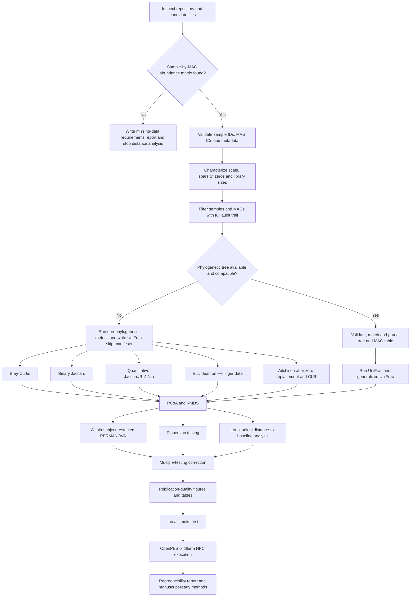

# Longitudinal MAG beta diversity

## Purpose and current data

Beta diversity quantifies differences in community composition between samples; alpha diversity summarizes diversity within each sample. This workflow analyzes sample-level gut MAG profiles across the BlackICE Summit expedition. It never treats per-MAG coefficients, p-values, or fitted model summaries as a community matrix.

Inputs are supplied separately. Validate schemas, exact sample/taxonomy joins, scale, missingness and tree requirements before analysis.

## Required inputs

- Abundance CSV: one unique `sampleID` row per biological sample; all remaining columns are unique MAG IDs with finite non-negative sample-level abundance values.
- Metadata CSV: one unique row per sample with subject, sampling date/timepoint, and available covariates.
- Taxonomy CSV: one unique genome row keyed to MAG identifiers.
- Optional tree: rooted Newick/Nexus tree with finite non-negative branch lengths and MAG tip labels. Taxonomy labels are not a substitute.

Unknown fields must be `null` in [beta_diversity.yml](../../config/beta_diversity.yml). Validation fails rather than guessing critical IDs. Current canonical mappings are `sampleID`, subject `group`, ordered `Timepoint`, date `date`, and taxonomy ID `Genome`.

## Preprocessing and metrics

Validation checks duplicates, numeric type, finite and non-negative values, all-zero rows/columns, ID matching, row sums, prevalence, sparsity, and raw checksums. Filtering thresholds are configuration-controlled; all exclusions are written to `qc/`. Current defaults remove unusable zeros and require 5% prevalence, with 10% sensitivity planned. All 441 MAGs currently pass both prevalence thresholds.

- Bray-Curtis: total-sum scaling followed by square root. Untransformed relative abundance is a sensitivity branch configured separately.
- Binary Jaccard: strict presence above the configured detection threshold. A 1e-6 threshold is specified for sensitivity analysis.
- Quantitative Jaccard/Ružička: non-negative relative profiles; the output name removes the ambiguity of “weighted Jaccard.”
- Euclidean Hellinger: Euclidean distance after square-root relative abundance.
- Aitchison: row-wise multiplicative zero replacement, CLR, then Euclidean distance. Replacement fraction, zero count, and CLR checks are recorded; no `log(0)` is possible.
- UniFrac: requires a valid tree. Mismatches are reported before pruning. Generalized UniFrac uses configured alpha 0, 0.5, and 1; alpha 0.5 is primary when available.

Each valid metric produces an R `dist` object, long table, manageable matrix TSV, summary, sample order, checksum, preprocessing manifest, and transformed matrix used for verification.

## Ordination and inference

PCoA is run for every valid distance. Negative eigenvalues are quantified; Lingoes correction is applied when their absolute contribution exceeds 1%, with both the uncorrected diagnostic and correction recorded. Bray-Curtis and binary Jaccard also receive two-dimensional NMDS with fixed seed, multiple starts, convergence, stress, and Shepard diagnostics.

The primary model is `distance ~ subject_id + timepoint`, tested by `vegan::adonis2` with subject represented as a fixed blocking term and permutations restricted within subject. Only the timepoint term is interpreted. This is a blocked permutation test, not a random-intercept PERMANOVA. Because age and gender are between-subject variables, that same restriction cannot test them. Altitude is tied to expedition time and is reserved for a separate sensitivity hypothesis. Pairwise tests run only after a justified global test, retain subject blocks, and use BH adjustment.

`betadisper` and its permutation test accompany PERMANOVA. A significant PERMANOVA may represent centroid separation, dispersion heterogeneity, or both. Distance to each subject’s earliest observed gut sample is analyzed with `distance ~ days + (1 | subject)` as an exploratory LMM. Adjacent observed windows are summarized without pretending missing windows are adjacent scheduled visits.

## Figures and outputs

Figures use a consistent colorblind-accessible palette, redundant point shapes, restrained subject trajectories, vector PDF, and 400-dpi PNG. PCoA axes show represented variation; NMDS diagnostics show stress. Confidence ellipses are intentionally omitted because several timepoints have small or unequal sample counts. Captions are in `figure_captions.md`.

Output directories are `audit/`, `qc/`, `prepared_data/`, `distances/`, `ordination/`, `statistics/`, `figures/`, `tables/`, `reports/`, `logs/`, and `provenance/`. Existing analytical outputs are not overwritten unless `--force` is supplied or a separate output directory is configured.

## Workflow



## Running locally

```bash
Rscript analysis/beta_diversity/09_create_smoke_test_data.R --config config/beta_diversity.yml
bash scripts/run_beta_diversity_local.sh --config config/beta_diversity_test.yml --force
bash scripts/run_beta_diversity_local.sh --config config/beta_diversity.yml
bash scripts/run_beta_diversity_local.sh --config config/beta_diversity.yml --from-stage 4
bash scripts/run_beta_diversity_local.sh --config config/beta_diversity.yml --metric aitchison
```

The derived smoke subset contains 16 samples from four subjects at four shared timepoints and 60 varying MAGs selected deterministically. It tests parsing, matching, filtering, zero handling, all non-phylogenetic metrics, PCoA, NMDS, restricted PERMANOVA, dispersion, plots, report generation, and reproducibility invariants. The command returns non-zero on failure.

## OpenPBS

The full-workflow OpenPBS launcher uses four CPUs, 16 GB memory, and a four-hour
walltime. Update the existing Conda environment first, then submit both jobs from
the repository root:

```bash
qsub hpc/update_glmm_env.pbs
qsub hpc/beta_diversity_full.pbs
```

Wait for the environment-update job to succeed before submitting the analysis.
The beta-diversity job defaults to `config/beta_diversity.yml` and the
`glmm-hpc` environment. Useful overrides include:

```bash
qsub -v CONDA_MODULE_NAME=intelpython/2022.2.0,CONDA_ENV_NAME=glmm-hpc hpc/beta_diversity_full.pbs
qsub -v BETA_CONFIG=config/beta_diversity_test.yml,BETA_FORCE=1 hpc/beta_diversity_full.pbs
```

Monitor with `qstat -u "$USER"`. The combined scheduler log is
`blackice_beta_diversity.pbs.log`, and detailed stdout/stderr logs are written
under `logs/`. Existing analytical outputs remain protected unless
`BETA_FORCE=1` is explicitly supplied.

## Slurm

Edit the placeholder account and partition before submission. Jobs are never submitted automatically.

```bash
sbatch hpc/beta_diversity_full.slurm
sbatch --dependency=afterok:<array_job_id> hpc/beta_diversity_report.slurm
sbatch hpc/beta_diversity_metric_array.slurm
```

Prepare dependencies on a login node with `environment.yml` or `renv::restore()`;
compute nodes should not require internet. The OpenPBS full-workflow launcher is
separate from these Slurm launchers; keep using the scheduler-specific file for
each cluster.

## Troubleshooting and limitations

- `FAILED_NO_SAMPLE_BY_MAG_MATRIX`: supply sample-level profiles, not model summaries.
- `FAILED_METADATA_ID_MISMATCH`: reconcile IDs upstream; do not silently drop abundance samples.
- `SKIPPED_UNIFRAC_NO_TREE`: provide a rooted branch-length MAG tree whose tips use `Genome` identifiers.
- Low NMDS quality: inspect stress and consider the saved PCoA or optional 3D sensitivity result.
- Too few permutations: report complete enumeration or realized restrictions; do not claim finer p-value precision.
- Upstream normalization requires separate provenance. Observational, unbalanced sampling and time/altitude confounding limit causal and covariate interpretations.

Full citations and package links are in [references.md](references.md).
